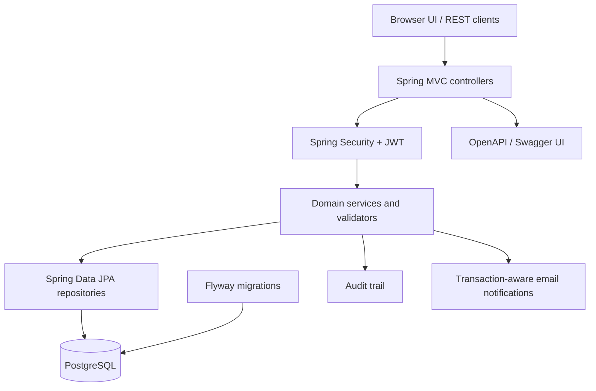

<div align="center">

# HackHub

### Discover. Collaborate. Deliver.

A hackathon management platform for discovering events, building teams, submitting projects and managing evaluation — built with Java and Spring Boot, with a responsive browser UI and a REST API.

**[Getting started](#getting-started) · [Features](#features) · [Architecture](#architecture) · [UML design](#uml-design) · [API](#api-overview) · [Security](#security-notes)**

</div>

---

## Overview

HackHub brings the main stages of a hackathon into one application. Participants can discover events, create teams and collaborate; organizers and judges can manage event progress, review submissions, evaluate projects and publish the final leaderboard. The platform also includes moderation, support requests, audit logging and optional email notifications.

The backend is implemented as a **modular monolith**. This keeps domain rules and transactions in one deployable application while leaving clear boundaries between controllers, services, persistence and external integrations. The browser interface is served directly by Spring Boot, so no separate frontend build is required.

## Features

- **Browser UI:** responsive landing page, event discovery, search, filters, pagination, event details, authentication dialogs and public leaderboards for closed events.
- **Authentication:** participant registration, login, BCrypt password hashing, signed JWT bearer tokens and stateless Spring Security.
- **Role and ownership checks:** participant and staff permissions, with event-specific authorization enforced in the service layer.
- **Hackathon lifecycle:** guarded transitions through registration, ready-to-start, running, evaluation and closure.
- **Teams and invitations:** team creation, invitations, invitation acceptance/rejection and event registration.
- **Submissions and judging:** project submissions, judge evaluations and safeguards around closing an evaluation phase.
- **Ranking:** score-based results, penalty handling and configurable tie-breaking strategies.
- **Moderation and support:** reports, sanctions, report archiving, support requests, replies and support-call requests.
- **Audit trail:** records mutating API operations with actor and request context.
- **Email notifications:** invitation emails can be sent after transaction commit when SMTP is configured.
- **API documentation:** OpenAPI specification and Swagger UI, including bearer-token authentication support.
- **Observability:** Spring Boot Actuator health/info endpoints and Micrometer Prometheus metrics.
- **Database migrations:** PostgreSQL schema migrations managed by Flyway; Hibernate validates the schema in the `postgres` profile.
- **Developer workflow:** Maven Wrapper, Docker Compose, GitHub Actions CI and CodeQL analysis.

## Technology stack

| Area | Technologies |
|---|---|
| Language | Java 17 |
| Backend | Spring Boot 4.1, Spring MVC, Spring Data JPA, Hibernate |
| Security | Spring Security, JWT (JJWT), BCrypt |
| Databases | PostgreSQL 16, Flyway; H2 for local development |
| Validation and documentation | Jakarta Bean Validation, Springdoc OpenAPI / Swagger UI |
| Monitoring | Spring Boot Actuator, Micrometer, Prometheus registry |
| Testing | JUnit 5, Spring Boot Test, Testcontainers |
| Packaging and local infrastructure | Maven Wrapper, Docker, Docker Compose |
| Automation | GitHub Actions, CodeQL |
| Frontend | HTML, CSS and vanilla JavaScript, served as Spring Boot static resources |

> **Spring Boot 4 note:** the project uses `spring-boot-starter-flyway` to activate Flyway auto-configuration, `flyway-database-postgresql` for PostgreSQL support, and `spring-boot-starter-aspectj` for the audit aspect.

## Getting started

### Prerequisites

- A JDK 17 or newer (not just a JRE) for local execution.
- Docker Engine/Desktop with the Docker Compose plugin for the PostgreSQL setup.
- Internet access on the first Maven Wrapper run so it can download the configured Maven distribution and dependencies.

### Option A — Run the full stack with Docker Compose (recommended)

1. Create a local environment file from the template:

   ```bash
   cp .env.example .env
   ```

   On Windows PowerShell:

   ```powershell
   Copy-Item .env.example .env
   ```

2. Edit `.env` and replace the sample values. In particular, set a unique database password, a random `JWT_SECRET` of at least 32 UTF-8 bytes and a long `HACKHUB_STAFF_REGISTRATION_KEY`. Do not reuse these values in a public deployment.

3. Build and start the application and PostgreSQL:

   ```bash
   docker compose up --build
   ```

4. Open the application:

   | Resource | URL |
   |---|---|
   | HackHub web interface | <http://localhost:8080/> |
   | Swagger UI | <http://localhost:8080/swagger-ui.html> |
   | OpenAPI JSON | <http://localhost:8080/v3/api-docs> |
   | Health check | <http://localhost:8080/actuator/health> |

Stop the services with `Ctrl+C`, or run `docker compose down` from another terminal. The named volume `hackhub-postgres-data` preserves PostgreSQL data. **`docker compose down -v` also deletes that volume and its data.**

The Compose setup activates the `postgres` profile, runs Flyway migrations and uses Hibernate schema validation. `JWT_SECRET` must be explicitly configured. SMTP settings are optional; email delivery will not work until a mail server is configured.

### Option B — Run locally with H2

With a JDK 17 or newer installed, run from the project root:

```bash
./mvnw spring-boot:run
```

On Windows:

```powershell
.\mvnw.cmd spring-boot:run
```

The default `local` profile uses an in-memory H2 database. It is intended for development: data is disposable and is lost when the application stops. The web interface is served at <http://localhost:8080/>.

### Run tests

```bash
./mvnw --batch-mode --no-transfer-progress verify
```

On Windows PowerShell, run:

```powershell
.\mvnw.cmd --batch-mode --no-transfer-progress verify
```

The test suite covers token handling, validation, lifecycle rules, frontend access control and PostgreSQL schema creation. The PostgreSQL integration test uses Testcontainers and is skipped when Docker is not available. The GitHub Actions workflow runs Maven verification on pushes and pull requests, then builds the container image.

## Try the API

Swagger UI is the source of truth for the complete request and response schemas. Protected routes use the header:

```http
Authorization: Bearer <accessToken>
```

### 1. Register a participant

```bash
curl -X POST http://localhost:8080/api/auth/register \
  -H 'Content-Type: application/json' \
  -d '{
    "username": "alexbuilds",
    "email": "alex@example.com",
    "name": "Alex",
    "surname": "Morgan",
    "password": "use-a-long-unique-password"
  }'
```

The response includes an access token, its type and lifetime, the account role and subject ID. Passwords must be at least 12 characters; BCrypt's 72-byte UTF-8 limit is enforced by the application.

### 2. Log in

```bash
curl -X POST http://localhost:8080/api/auth/login \
  -H 'Content-Type: application/json' \
  -d '{"username":"alexbuilds","password":"use-a-long-unique-password"}'
```

Participants sign in with their username; staff accounts use their email address as username. Copy `accessToken` from the response for protected requests. The browser UI stores the token in `sessionStorage` for the current tab session.

### 3. Provision a staff account

Staff account registration is disabled unless `HACKHUB_STAFF_REGISTRATION_KEY` is configured. Once configured, call the provisioning route with that key:

```bash
curl -X POST http://localhost:8080/api/auth/staff/register \
  -H 'Content-Type: application/json' \
  -H 'X-Staff-Registration-Key: <configured-key>' \
  -d '{
    "email": "organizer@example.com",
    "name": "Jamie",
    "surname": "Organizer",
    "password": "use-a-long-unique-password"
  }'
```

This route is intended as a bootstrap mechanism for a local or portfolio deployment. Before production use, replace shared-key provisioning with an audited administrator workflow or an identity provider.

### 4. Create a team

Use the participant token:

```bash
curl -X POST http://localhost:8080/api/teams \
  -H "Authorization: Bearer $TOKEN" \
  -H 'Content-Type: application/json' \
  -d '{"name":"Weekend Builders"}'
```

Use Swagger UI to inspect the current schemas and try event registration, invitations, submissions, evaluations, moderation and support workflows.

## API overview

The principal routes are summarized below. For request bodies, response DTOs and all parameters, use Swagger UI.

| Area | Method and route | Access |
|---|---|---|
| Authentication | `POST /api/auth/register` | Public; participant registration |
| Authentication | `POST /api/auth/login` | Public; rate limited |
| Authentication | `POST /api/auth/staff/register` | Provisioning key required |
| Accounts | `GET /api/users/me` | Authenticated |
| Hackathons | `GET /api/hackathons/search` | Public; filters and pagination |
| Hackathons | `GET /api/hackathons/{id}` | Public |
| Hackathons | `GET /api/hackathons/{id}/leaderboard` | Public after event closure |
| Hackathons | `POST /api/hackathons` | Staff; authorization enforced by service |
| Hackathons | `POST /api/hackathons/{id}/register` | Participant |
| Hackathon lifecycle | `POST /api/hackathons/{id}/close-registration` | Staff; event authorization applies |
| Hackathon lifecycle | `POST /api/hackathons/{id}/start` | Staff; event authorization applies |
| Hackathon lifecycle | `POST /api/hackathons/{id}/start-evaluation` | Staff; judge assignment applies |
| Hackathon lifecycle | `POST /api/hackathons/{id}/evaluations/confirm` | Staff; judge assignment applies |
| Hackathon lifecycle | `POST /api/hackathons/{id}/declare-winner` | Staff; organizer authorization applies |
| Hackathon lifecycle | `POST /api/hackathons/{id}/prize-payout` | Staff; organizer authorization applies |
| Teams | `POST /api/teams` | Participant |
| Invitations | `/api/invitations` | Participant; recipient/team rules apply |
| Submissions | `/api/hackathons/{id}/submissions` | Participant to submit; staff to review |
| Evaluations | `POST /api/hackathons/{id}/submissions/{subId}/evaluations` | Staff; judge assignment applies |
| Reports | `/api/hackathons/{id}/reports` | Staff only |
| Support | `/api/hackathons/{id}/support-requests` | Participant to create; staff to review/reply |

Hackathon search supports `nameContains`, `status`, `isOnline`, `startsAfter` and `startsBefore`, plus `page`, `size` and sorting. Page size is capped at 100; supported sort fields are restricted to `id`, `name`, `prize`, `status` and `online`.

## Architecture



The main code is organized by responsibility:

```text
src/main/java/it/unicam/hackhub/
├── auth/             Registration, login, accounts and roles
├── controller/       REST endpoints
├── security/         JWT validation, Spring Security and rate limiting
├── service/          Business workflows and orchestration
├── model/            Entities, enums, value objects and DTOs
├── repository/       Spring Data persistence interfaces
├── validators/       Domain-level validation
├── audit/            Audit events and aspect-based logging
├── notifications/    Transaction-aware email notifications
├── config/           API error handling and OpenAPI configuration
└── utils/
    ├── adapters/     Payment and calendar integration boundaries
    ├── builders/     Hackathon builder
    ├── facade/       Calendar integration facade and token stores
    └── strategy/     Ranking and tie-breaking strategies

src/main/resources/
├── static/           HTML, CSS and JavaScript frontend
└── db/migration/     Flyway SQL migrations
```

## UML design

The repository root includes the Visual Paradigm project used to model the system, `HackHub.vpp`, alongside files such as `pom.xml` and the `src/` directory. It is provided as a design reference for reviewers and is **not required** to compile or run the application.

- **Model file:** [`HackHub.vpp`](HackHub.vpp) (repository root)
- **Tool:** Visual Paradigm
- **Purpose:** provides the UML design artifacts associated with the HackHub implementation.

The Java source code and automated tests remain the source of truth for the implemented behavior; the UML file is supplementary documentation.

## Design decisions

- **Modular monolith:** domain rules and transactions remain within one deployable service; split into services only if real scaling or team boundaries justify it.
- **Signed bearer tokens:** clients cannot choose their own role, and protected routes derive the actor identity from validated JWT claims rather than trusting a client-supplied ID.
- **Service-level authorization:** checks involving event ownership, judge assignment and participant/team relationships are enforced in the business layer as well as by route-level roles.
- **Explicit lifecycle rules:** state transitions are validated instead of allowing arbitrary status changes.
- **Strategy pattern for ranking:** tie-breaking policies are selected explicitly, keeping ranking rules isolated from event orchestration.
- **Builder and adapter/facade boundaries:** construction of hackathons and external payment/calendar integrations are separated from core business logic.
- **Versioned schema:** PostgreSQL migrations are tracked by Flyway; Hibernate validates the migrated schema in the PostgreSQL profile.
- **Audit and notifications:** mutating operations are auditable, and invitation notifications are triggered after transaction commit.

## Configuration

Docker Compose reads environment values from `.env`. The tracked `.env.example` is a template only; copy it locally and replace every placeholder before starting the stack.

| Variable | Purpose |
|---|---|
| `SPRING_PROFILES_ACTIVE` | `postgres` in Docker Compose; local profile is the default outside Compose |
| `DB_URL`, `DB_USERNAME`, `DB_PASSWORD` | Database connection settings |
| `POSTGRES_DB`, `POSTGRES_USER`, `POSTGRES_PASSWORD`, `POSTGRES_PORT` | PostgreSQL container settings |
| `APP_PORT` | Host port mapped to the application; defaults to `8080` |
| `JWT_SECRET` | Signing secret; required for the PostgreSQL profile and must be strong (at least 32 UTF-8 bytes) |
| `JWT_EXPIRATION_SECONDS` | Token lifetime in seconds |
| `HACKHUB_STAFF_REGISTRATION_KEY` | Secret used to bootstrap staff accounts; blank disables staff registration |
| `HACKHUB_MAIL_FROM` | Sender address for invitation emails |
| `SPRING_MAIL_HOST`, `SPRING_MAIL_PORT`, `SPRING_MAIL_USERNAME`, `SPRING_MAIL_PASSWORD` | Optional SMTP settings |

Never commit `.env`, real credentials, OAuth tokens or production signing keys. The repository's `.gitignore` excludes local environment files while allowing `.env.example` to be committed.

## Security notes

HackHub is a portfolio/demo project and should not be exposed to untrusted users without further hardening. In particular:

- Replace staff shared-key provisioning with a managed administrator process or identity provider.
- Add email verification, password reset, token revocation and multi-factor authentication before real-world use.
- Treat browser-side token storage as an explicit security trade-off; harden against cross-site scripting and consider a secure, HttpOnly cookie design if the frontend architecture changes.
- Move rate-limit state to a shared store and configure trusted proxies correctly before running multiple instances.
- Use unique secrets and database credentials per environment; terminate TLS at a trusted reverse proxy or platform.

## Known limitations and roadmap

- **Payments are not live.** Payment adapters in the local profile simulate outcomes; they do not transfer funds. The PostgreSQL profile does not configure a live payout provider. Real payouts require provider SDK integration, secret management, idempotency, reconciliation and end-to-end tests.
- **Google Calendar needs OAuth setup.** The adapter boundary exists, but durable secure storage of per-staff OAuth refresh tokens and the consent/callback lifecycle still need implementation before real calendar events can be created.
- **Rate limiting is in-memory.** It is useful for a single-instance demo but is not shared across multiple application instances.
- **Identity lifecycle is basic.** Email verification, password reset, MFA and token revocation remain future work.
- **Email scope is limited.** Invitation email is supported when SMTP is configured; deadline reminders, durable retry queues and delivery-status tracking are not implemented.
- **Frontend scope is intentionally lean.** It covers public discovery and core account/event interactions; richer participant, organizer and judge workspaces are future improvements.
- **Production observability needs more work.** Distributed tracing, dashboards, centralized log aggregation and alerting are not configured.

## Contributing

1. Create a focused branch for the change.
2. Add or update tests for the affected business rules and authorization checks.
3. Run `./mvnw --batch-mode --no-transfer-progress verify`.
4. Open a pull request describing the change, relevant tests and any configuration or migration updates.

Please do not present simulated payment/calendar integrations as live services, and never commit secrets.
